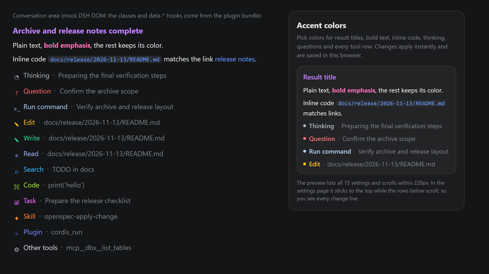
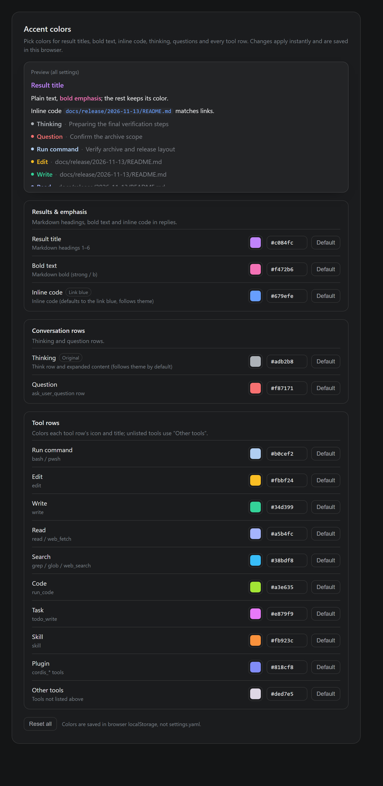

# dsh-ui-accent · accent colors for DSH

English | [简体中文](./README.md)

Colorize the conversation area of DeepSeek Harness (DSH) by meaning, then pick every color in **Settings → Accent colors**. Changes apply instantly and are stored in your browser (`localStorage`) — never in `settings.yaml`.

The plugin ships as a **DSH bundle** on npm: `@feiry-zz/dsh-ui-accent`. Install it by package name from the DSH plugin manager — on Windows, macOS and Linux alike.

The panel follows the DSH locale setting (all 8 languages DSH ships, via the `locale` service), and its live preview lists all 15 categories inside a fixed-height scroll area.



Settings panel: the preview box is 220px tall and sticks to the top of the content area, so it stays visible while you scroll through the rows below; a new color is immediately comparable.



## Features

- **Color by meaning**: result titles (Markdown headings), bold text, inline code, thinking, questions, plus 10 tool categories — run command, edit, write, read, search, code, task, skill, plugin and other tools (15 in total).
- **Smooth dragging**: while you drag the color picker, changes are coalesced into one CSS variable write per frame and only the changed variable is touched; persistence and preview scrolling wait until you pause, so the picker stays responsive.
- **Follows the DSH locale**: registers the `settings.uiAccent` namespace on the DSH `locale` service for all 8 languages DSH ships — Chinese, English, 日本語, Español, Français, Deutsch, Русский, Português; the panel and the sidebar entry update as soon as you switch.
- **Evolving defaults**: storage keeps only values that differ from the built-in defaults, so untouched categories pick up a new default automatically.
- **Theme aware**: thinking and inline code are not overridden by default — they keep the DSH grey and the link blue, and follow light/dark themes.

## Default palette

| Category | Applies to | Default |
| --- | --- | --- |
| Result title | Markdown headings 1–6 | `#c084fc` purple |
| Bold text | Markdown `strong` / `b` | `#f472b6` pink |
| Inline code | Markdown inline code (including links and file references) | Same as links (`--dsw-alias-state-business-primary`, follows theme) |
| Thinking | `data-variant="think"` rows (title, icon, summary, expanded body) | Not overridden — keeps the DSH grey |
| Question | `data-tool="ask_user_question"` row | `#f87171` red |
| Run command | `bash` / `pwsh` | `#b0cef2` light blue |
| Edit | `edit` | `#fbbf24` amber |
| Write | `write` | `#34d399` green |
| Read | `read` / `web_fetch` | `#a5b4fc` indigo |
| Search | `grep` / `glob` / `web_search` | `#38bdf8` sky blue |
| Code | `run_code` | `#a3e635` lime |
| Task | `todo_write` | `#e879f9` magenta |
| Skill | `skill` | `#fb923c` orange |
| Plugin | `cordis_*` tools | `#818cf8` blue-violet |
| Other tools | Anything not listed above | `#ded7e5` light lavender |

Every category can be changed independently, and **Reset all** restores the defaults. Two categories are special:

- **Inline code** defaults to the *link blue*: it reuses the `--dsw-alias-state-business-primary` token (`#679efe` in dark, `#4176e6` in light), so plain inline code, link-style inline code and file references all render in the same blue that follows the theme. Pick a color to override it; **Default** returns to link blue.
- **Thinking** defaults to the *original* color: nothing is overridden, so it keeps the DSH theme grey. Pick a color to override it; **Default** returns to the original.

## Usage

1. Open **Settings** in DSH — **Accent colors** appears in the left navigation.
2. Click a color swatch or type a hex value; the conversation area updates immediately.
3. Choices are stored in the browser's `localStorage`. Inline code keeps following the theme's link blue by default; other custom colors stay fixed when you switch light/dark themes.
4. The **Preview (all settings)** box at the top of the panel lists all 15 categories, scrolls within 220px, and **sticks to the top** of the settings content area.
5. After you pick a color, the preview scrolls to that category's sample row so you can compare right away.

> If **Accent colors** does not show up in Settings yet, refresh the window once (`Ctrl+R`).

## Install

The plugin ships as a **DSH bundle** on npm — `@feiry-zz/dsh-ui-accent`. Pick either method below.

### Option 1: plugin manager (recommended, works everywhere)

In DSH open **Settings → Plugins → Add plugin** and enter the package name or address:

```
@feiry-zz/dsh-ui-accent
```

You can also pin a version (`@feiry-zz/dsh-ui-accent@0.3.1`) or paste the Git repository URL (`https://github.com/Feiry-zZ/dsh-ui-accent.git`) to install from source. DSH layers the bundle patch (`cordis.patch.yml`) onto the profile, which activates the plugin. Refresh the window once (`Ctrl+R` / `Cmd+R`) if the settings entry is not there yet. No Node, no manual links.

### Option 2: local link (for hacking on the code)

Best when you want to edit the checkout and rely on HMR:

```bash
git clone git@github.com:Feiry-zZ/dsh-ui-accent.git
cd dsh-ui-accent
node install.mjs
```

The script only uses the Node standard library (so **Windows, macOS and Linux** behave the same) and does two things under `<DSH_HOME>/profiles/desktop` (`<DSH_HOME>` defaults to `~/.dsh`, override with the `DSH_HOME` environment variable):

1. creates `node_modules/@feiry-zz/dsh-ui-accent` as a directory link to this repository — a junction on Windows, a symlink on macOS and Linux;
2. appends this entry to the profile's `cordis.patch.yml`:

```yaml
- insert:
    - id: ui-accent
      name: '@feiry-zz/dsh-ui-accent'
```

No script needed if you prefer the manual route — it is equivalent to the two steps above:

```bash
# Windows (CMD or PowerShell; create the scope directory first)
mkdir "%USERPROFILE%\.dsh\profiles\desktop\node_modules\@feiry-zz"
mklink /J "%USERPROFILE%\.dsh\profiles\desktop\node_modules\@feiry-zz\dsh-ui-accent" "D:\path\to\dsh-ui-accent"

# macOS / Linux
mkdir -p ~/.dsh/profiles/desktop/node_modules/@feiry-zz
ln -s "$(pwd)" ~/.dsh/profiles/desktop/node_modules/@feiry-zz/dsh-ui-accent
```

Then append the YAML block above to the end of the profile's `cordis.patch.yml`.

> ⚠️ The two methods are mutually exclusive: once installed through the plugin manager, do not run `install.mjs` — it would register a second `ui-accent` entry. Uninstall first if you want to switch.

On activation the host half appends a line to `<DSH_HOME>/logs/ui-accent.log`:

```
[2026-11-03T06:03:04.391Z] host half activated
[2026-11-03T06:03:04.697Z] client bundle ready rev=f96bd4d53c1a
```

(Later changes to the client bundle are hot-reloaded by `@deepseek-ai/dsh-client-hmr` and no longer reach the host log.)

## Repository layout

```
dsh-ui-accent/
├─ package.json           # dsh.bundle (bundle patch) + dsh.client (platform: web / inject)
├─ cordis.patch.yml       # bundle patch: registers the plugin entry itself
├─ locale/                # title and description shown by the plugin manager (8 languages)
├─ icon.svg               # plugin icon
├─ build.mjs              # inlines src/theme.css into lib/client.js
├─ install.mjs            # local-link install/uninstall script (cross-platform, Node stdlib only)
├─ LICENSE                # MIT license
├─ src/
│  ├─ client.js           # client plugin source (settings panel + color state)
│  └─ theme.css           # conversation-area selectors and panel styles (the single source of colors)
├─ lib/
│  ├─ index.js            # host half: activation log and startup-graph check
│  └─ client.js           # build output (the bundle DSH actually loads)
├─ test/
│  ├─ render-test.mjs        # panel structure / style injection / colors / persistence
│  ├─ migration-test.mjs     # v1 → v3 storage migration
│  ├─ stale-default-test.mjs # default changes vs. user choices
│  ├─ schedule-test.mjs      # frame coalescing and deferred persistence
│  └─ package-test.mjs       # bundle packaging contract (bundle / files / exports / icon)
└─ preview/
   ├─ preview.html        # effect preview page (?lang=en for English)
   ├─ build-panel.mjs     # renders the real panel component to a static page
   └─ *.png               # README images
```

## Development

`src/theme.css` is the single source of truth for colors and selectors; `DEFAULTS` in `src/client.js` holds the factory palette. After editing:

```powershell
node build.mjs                   # build lib/client.js
node --check lib\client.js       # syntax check
node test\render-test.mjs        # all five tests should print OK
node test\migration-test.mjs
node test\stale-default-test.mjs
node test\schedule-test.mjs
node test\package-test.mjs
```

Regenerate the documentation images (Chrome required):

```powershell
# 1. Render the real panel component to static pages (Chinese and English)
node preview\build-panel.mjs

# 2. Take the screenshots in headless mode (replace <repo> with the absolute repo path)
chrome --headless=new --hide-scrollbars --force-device-scale-factor=2 --window-size=790,1620  --screenshot=preview\panel.png    "file:///<repo>/preview/panel.html"
chrome --headless=new --hide-scrollbars --force-device-scale-factor=2 --window-size=790,1620  --screenshot=preview\panel-en.png "file:///<repo>/preview/panel-en.html"
chrome --headless=new --hide-scrollbars --force-device-scale-factor=2 --window-size=1000,560  --screenshot=preview\preview.png    "file:///<repo>/preview/preview.html"
chrome --headless=new --hide-scrollbars --force-device-scale-factor=2 --window-size=1000,560  --screenshot=preview\preview-en.png "file:///<repo>/preview/preview.html?lang=en"
```

Bundle changes are detected by `@deepseek-ai/dsh-client-hmr`, which reloads the plugin automatically; CSS-only edits go through the same path.

## Publish (maintainers)

The package name is scoped (`@feiry-zz/dsh-ui-accent`), so **the npm organization `feiry-zz` must exist** (npmjs.com → Organizations) and the publishing account must be a member of it — otherwise `npm publish` returns 403.

```powershell
npm pkg get name version        # confirm name and version
npm pack --dry-run             # inspect the tarball (lib / locale / icon / cordis.patch.yml)
npm publish --dry-run          # dry run
npm publish --access public    # real publish (prepublishOnly builds and runs all 5 tests first)
```

The version only affects the plugin manager's "Update to x.y.z available" hint; it is independent of the DSH version. Note that npm only allows `npm unpublish` within **72 hours** of publishing — after that you can only `npm deprecate`, and an unpublished version number can never be reused, so a fix must go out as a new version.

## Storage & compatibility

- Storage key `dsh-accent.colors.v3`, shape `{ version: 3, colors: {...} }`, holding only categories that differ from the defaults.
- The older `v2` envelope and the `v1` flat map are migrated on first load; values equal to a historical default (thinking's old orange `#fb923c`, skill's old teal `#2dd4bf`, other tools' old purple `#c084fc`) are treated as "never changed" and follow the current default, while real custom colors are preserved.
- Internal CSS variables keep the `--dsh-accent-*` prefix and the thinking switch stays `html[data-dsh-accent-think]` — the historical naming differs from the package name by design.
- Selectors rely on DSH's stable DOM contract: `data-tool` / `data-variant` on tool rows, `data-variant="think"` on thinking rows, and the `_markdown` prefix on Markdown roots. If a category stops being colored after a major DSH upgrade, check those hooks first and update `src/theme.css`.

## Uninstall

- **Plugin manager install**: uninstall the bundle in **Settings → Plugins** — it removes the plugin entry it registered.
- **Local link install**: `node install.mjs --uninstall` (removes the link and strips the entry from the profile's `cordis.patch.yml`, backing it up as `.bak` first).

Both need a window refresh (`Ctrl+R` / `Cmd+R`) before the settings page disappears: the host half unloads immediately, but the settings page and the color styles are registered by the client bundle.

To do the local-link variant by hand:

1. remove the `ui-accent` `insert` block (plus the two comment lines above it) from `cordis.patch.yml`;
2. remove the directory link:

```bash
# macOS / Linux
rm ~/.dsh/profiles/desktop/node_modules/@feiry-zz/dsh-ui-accent

# Windows (CMD)
rmdir "%USERPROFILE%\.dsh\profiles\desktop\node_modules\@feiry-zz\dsh-ui-accent"
```

Picked colors live in the browser's `localStorage` and survive uninstall; they come back on reinstall.

## License

[MIT](./LICENSE) © 2026 Feiry-zZ

Free to use, modify and redistribute, including commercially — just keep the copyright and license notice.
