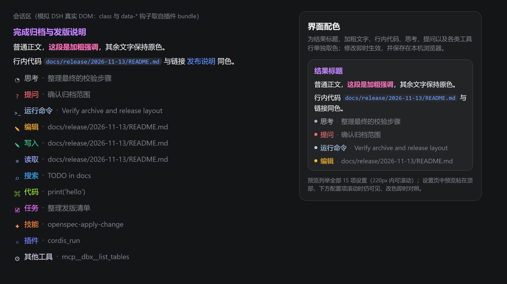
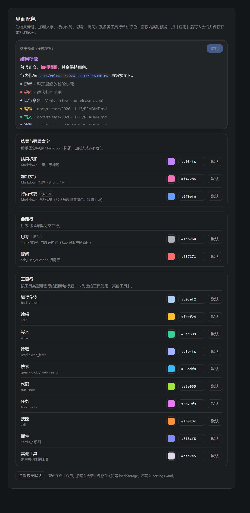

# dsh-ui-accent · DSH 界面配色插件

[English](./README.en.md) | 简体中文

给 DeepSeek Harness（DSH）的会话区按语义着色，并在「设置 → 界面配色」里逐项取色。面板内实时预览，点「应用」后写入会话并保存在本机浏览器（`localStorage`），不写入 `settings.yaml`。

插件以 **DSH 组合包（bundle）** 形式发布到 npm：`@feiry-zz/dsh-ui-accent`。在 DSH 的插件管理里填包名即可安装，Windows、macOS、Linux 通用。

界面文案跟随 DSH 通用设置的语言（`locale` 服务，覆盖 DSH 支持的全部 8 种语言）；效果预览列举全部 15 项设置，在固定高度内独立滚动，标题行右侧常驻「应用」按钮。



设置面板：预览区高 220px、粘在内容区顶部；下方配置项滚动时预览始终可见，改色即时对照，点「应用」后会话才更新。



## 特性

- **按语义着色**：结果标题（Markdown 标题）、加粗文字、行内代码、思考、提问，以及运行命令、编辑、写入、读取、搜索、代码、任务、技能、插件、其他工具共 15 类。
- **预览与生效分离**：拖动取色器只更新面板内的实时预览，不写页面根元素、不落盘；预览标题行右侧常驻「应用」按钮，有任意改动才启用，点击后才把差异项一次性写入会话并保存。拖动期间零全文档重算，长会话也不卡。
- **跟随 DSH 语言**：向 `locale` 服务注册 `settings.uiAccent` 命名空间，覆盖 DSH 支持的全部 8 种语言——中文、English、日本語、Español、Français、Deutsch、Русский、Português，切换语言后面板与侧边栏标题即时更新。
- **默认值可演进**：存储只保存「与出厂默认不同」的项，插件调整默认色时，没动过的分类自动跟随新默认。
- **主题友好**：思考与行内代码默认不覆盖，分别沿用 DSH 原色灰和超链接蓝，跟随深浅色主题。

## 默认配色

| 分类 | 作用对象 | 默认色 |
| --- | --- | --- |
| 结果标题 | Markdown 一至六级标题 | `#c084fc` 紫 |
| 加粗文字 | Markdown `strong` / `b` | `#f472b6` 粉 |
| 行内代码 | Markdown 行内代码（含链接、文件引用） | 与超链接同色（`--dsw-alias-state-business-primary`，跟随主题） |
| 思考 | `data-variant="think"` 推理行（标题、图标、摘要、展开正文） | 不覆盖，跟随 DSH 主题原色（灰） |
| 提问 | `data-tool="ask_user_question"` 行 | `#f87171` 红 |
| 运行命令 | `bash` / `pwsh` | `#b0cef2` 浅蓝 |
| 编辑 | `edit` | `#fbbf24` 琥珀 |
| 写入 | `write` | `#34d399` 绿 |
| 读取 | `read` / `web_fetch` | `#a5b4fc` 靛 |
| 搜索 | `grep` / `glob` / `web_search` | `#38bdf8` 天蓝 |
| 代码 | `run_code` | `#a3e635` 黄绿 |
| 任务 | `todo_write` | `#e879f9` 品红 |
| 技能 | `skill` | `#fb923c` 橙 |
| 插件 | `cordis_*` 系列 | `#818cf8` 蓝紫 |
| 其他工具 | 未单独列出的工具 | `#ded7e5` 浅烟紫 |

所有分类都可以单独修改，也可以一键「全部恢复默认」。这些操作都只改面板预览，点「应用」后才写入会话并保存。其中：

- **行内代码**默认标注「链接蓝」：与 DSH 超链接共用同一个 `--dsw-alias-state-business-primary` 令牌（深色 `#679efe`、浅色 `#4176e6`），普通行内代码、链接形式的行内代码、文件引用统一显示为蓝色，并随主题自动适配；取色后改为所选颜色，点「默认」回到链接蓝。
- **思考**默认标注「原色」：不覆盖，跟随 DSH 主题灰阶；取色后按所选颜色显示，点「默认」回到原色。

## 使用

1. 打开 DSH 的 **设置**，左侧导航出现 **界面配色**。
2. 点击任意分类的色块或直接输入十六进制色值；改动只写入面板内的「效果预览」，会话区暂时不变。
3. 预览标题行右侧的「应用」按钮在有改动后变为可用；点击它，差异分类才会写入会话并保存到浏览器 `localStorage`。
4. 行内代码默认跟随主题的链接蓝；其余自定义色在切换深浅色主题时保持不变。
5. 面板顶部的「效果预览（全部设置）」列举全部 15 项设置，高 220px、内部可滚动，并**粘在设置内容区顶部**；向下滚动配置项时预览与「应用」按钮始终可见。
6. 给某个分类取色后，预览会自动滚到该分类的样例行，改色效果立即可见。
7. 关闭设置面板会丢弃尚未应用的改动；重新打开时会从当前已应用配色开始。

> 若设置里暂时看不到「界面配色」，刷新一次界面（`Ctrl+R`）即可。

## 安装

插件以 **DSH 组合包（bundle）** 形式发布到 npm：**`@feiry-zz/dsh-ui-accent`**。两种安装方式任选其一。

### 方式一：插件管理安装（推荐，任何平台）

在 DSH 的 **设置 → 插件 → 添加插件** 里填入包名或地址：

```
@feiry-zz/dsh-ui-accent
```

也可以填 `@feiry-zz/dsh-ui-accent@0.3.1` 固定版本，或填 Git 仓库地址（`https://github.com/Feiry-zZ/dsh-ui-accent.git`）从源码安装。DSH 会把组合包补丁（`cordis.patch.yml`）叠加到 profile，插件随之激活；装完刷新界面（`Ctrl+R` / `Cmd+R`）即可在设置里看到「界面配色」。整个过程不需要 Node，也不需要手动建链接。

### 方式二：本地链接安装（改代码时用）

适合在仓库里直接改代码、靠 HMR 看效果：

```bash
git clone git@github.com:Feiry-zZ/dsh-ui-accent.git
cd dsh-ui-accent
node install.mjs
```

脚本只用 Node 标准库，**Windows、macOS、Linux 通用**，在 `<DSH_HOME>/profiles/desktop` 下做两件事（`<DSH_HOME>` 默认 `~/.dsh`，可用 `DSH_HOME` 环境变量覆盖）：

1. 在 `node_modules/@feiry-zz/dsh-ui-accent` 建一个指向本仓库的目录链接——Windows 用 junction，macOS、Linux 用符号链接；
2. 在 profile 的 `cordis.patch.yml` 追加插件登记：

```yaml
- insert:
    - id: ui-accent
      name: '@feiry-zz/dsh-ui-accent'
```

不想用脚本也可以手动做等价的两步：

```bash
# Windows（CMD 或 PowerShell 均可；带 scope 的包要先建好父目录）
mkdir "%USERPROFILE%\.dsh\profiles\desktop\node_modules\@feiry-zz"
mklink /J "%USERPROFILE%\.dsh\profiles\desktop\node_modules\@feiry-zz\dsh-ui-accent" "D:\path\to\dsh-ui-accent"

# macOS / Linux
mkdir -p ~/.dsh/profiles/desktop/node_modules/@feiry-zz
ln -s "$(pwd)" ~/.dsh/profiles/desktop/node_modules/@feiry-zz/dsh-ui-accent
```

然后把上面那段 YAML 追加到 profile 的 `cordis.patch.yml` 末尾。

> ⚠️ 两种方式互斥：通过插件管理装过之后不要再运行 `install.mjs`，否则会重复注册 `ui-accent` 条目；切换方式前先卸载。

Host 端激活后会写一行日志到 `<DSH_HOME>/logs/ui-accent.log`，可用于确认加载状态：

```
[2026-11-03T06:03:04.391Z] host half activated
[2026-11-03T06:03:04.697Z] client bundle ready rev=f96bd4d53c1a
```

（上述为首次装载时的示例；之后客户端 bundle 的改动由 `@deepseek-ai/dsh-client-hmr` 直接热重载，不再写 Host 日志。）

## 开发

构建、测试、打包契约与发布流程见 [AGENTS.md](./AGENTS.md)。

## 卸载

- **插件管理安装**：在 **设置 → 插件** 里卸载本组合包（会连同它注册的插件条目一起移除）。
- **本地链接安装**：`node install.mjs --uninstall`（删链接并从 profile 的 `cordis.patch.yml` 移除条目，改动前备份为 `.bak`）。

两种方式都需要刷新界面（`Ctrl+R` / `Cmd+R`）才能让设置面板消失：Host 侧立即卸载，但设置页与配色样式由客户端 bundle 注册。

不想用脚本就手动做等价的两步：

1. 从 `cordis.patch.yml` 删除 `ui-accent` 的 `insert` 块（连同上方两行注释）；
2. 删除目录链接：

```bash
# macOS / Linux
rm ~/.dsh/profiles/desktop/node_modules/@feiry-zz/dsh-ui-accent

# Windows（CMD）
rmdir "%USERPROFILE%\.dsh\profiles\desktop\node_modules\@feiry-zz\dsh-ui-accent"
```

已应用的配色保存在浏览器 `localStorage`，卸载不会清除，重装后自动恢复。

## 许可

[MIT](./LICENSE) © 2026 Feiry-zZ

可以自由使用、修改、分发（含商用），保留版权声明与许可声明即可。
